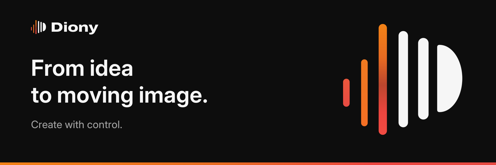
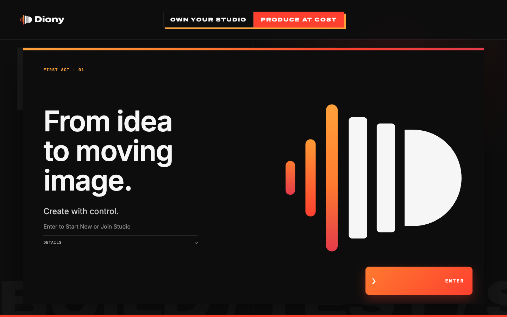
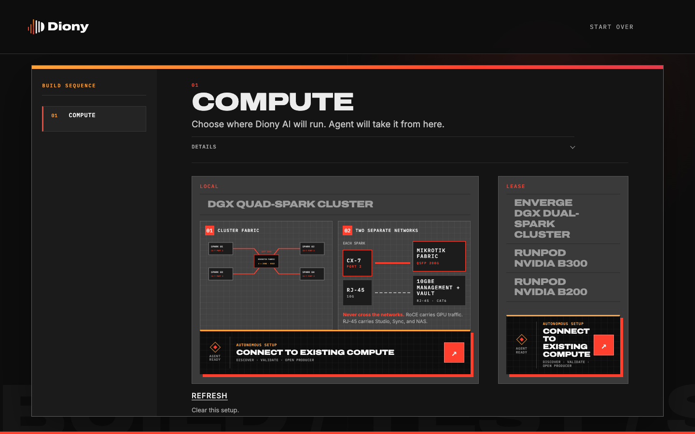
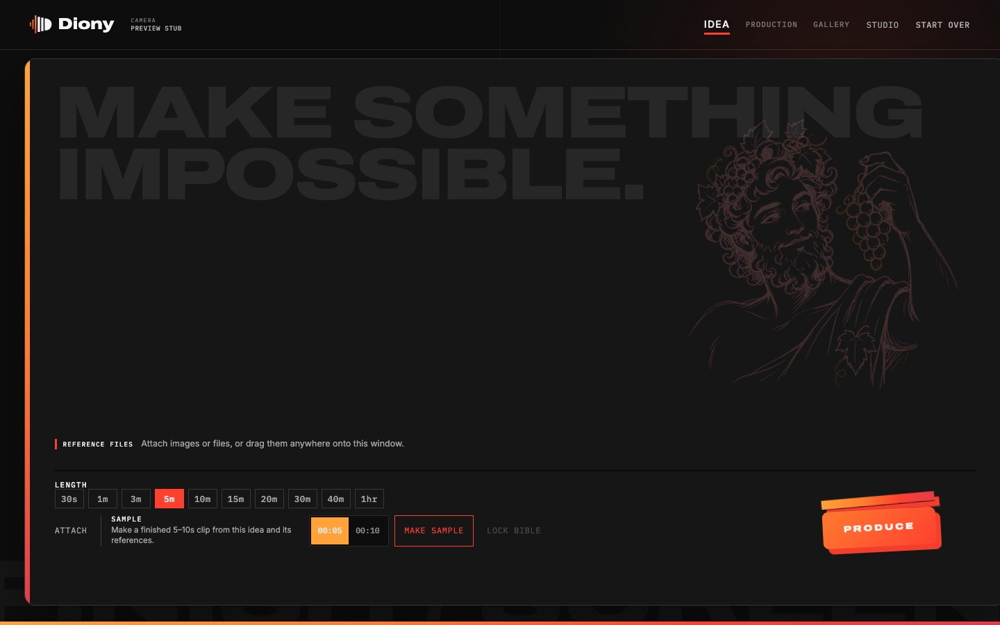
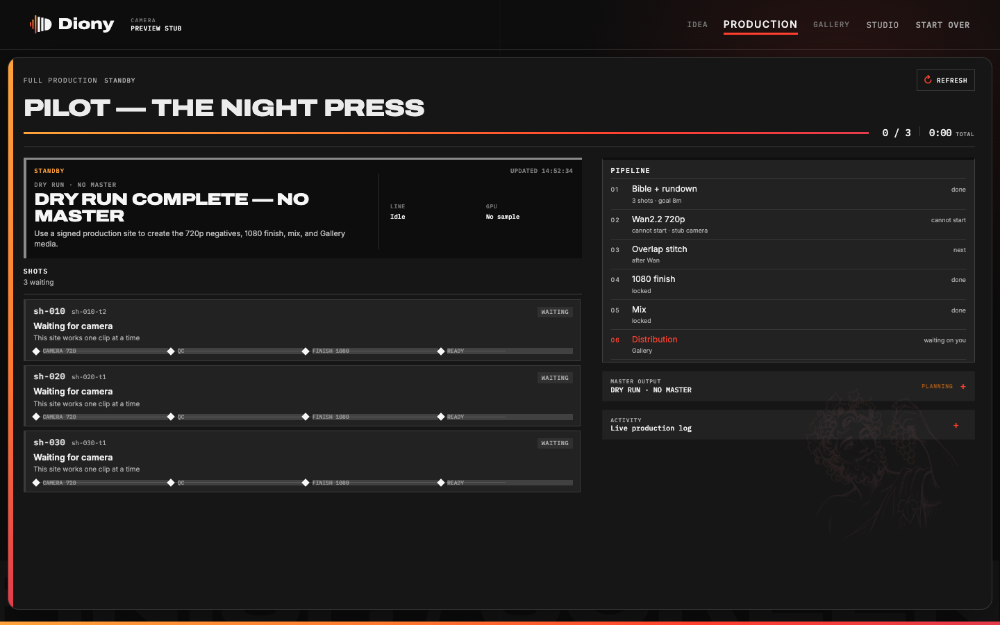
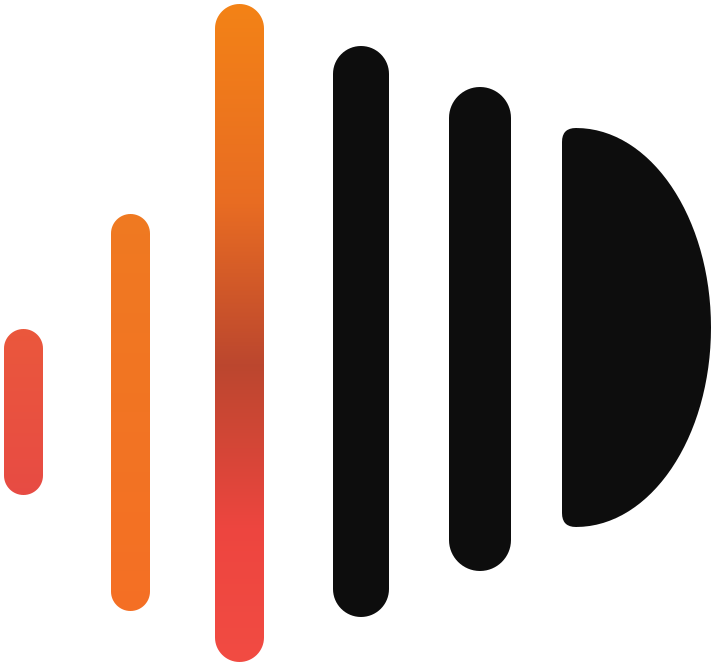

<div align="center">



<br />

**OWN YOUR STUDIO&nbsp;&nbsp;·&nbsp;&nbsp;PRODUCE AT COST**

<br />


<br />

[Open Diony AI](#open-diony-ai-no-terminal) · [Surfaces](#the-surfaces) · [Capabilities](#what-diony-does-today) · [Hardware](#hardware--compute-paths) · [Models](#models-local-never-cloud-by-default) · [Engineers](#run-the-shells-engineers) · [Blueprints](blueprints/)

</div>


Diony AI is the packaged product that turns a **4× NVIDIA DGX Spark** desk cluster into a local TV/movie production appliance. Unbox the hardware, run the **Studio**, and the cluster becomes the **Producer**: a showrunner tool that can spend days making a **1-hour 1080p** audiovisual program with dialogue, score, and SFX. Humans stay in the loop only for review, notes, and distribution.

Diony is an **Open Source Content Producer** in spirit: a maker-first production system where prompts, assets, model lineage, costs, and masters stay visible and portable. Your studio is not a black box and your project has an exit door — a complete `.diony.zip` carries its contracts, media, lineage, audit history, and checksums without credentials. This creator-sovereignty promise does not change the repository license; see [LICENSE](LICENSE) and [NOTICE](NOTICE).

This is not a notebook, a loose ComfyUI graph, or a cloud API wrapper. It is **Infrastructure as a Product**: versioned cluster profiles, a crate-to-cluster Studio, and a Producer that treats the fleet as a mode-switching camera-and-cutting-room. A validated official ComfyUI Wan workflow can be selected as a controlled camera backend; Diony still owns contracts, gates, logging, finish, and distribution.

## The product

| | |
|:---:|:---:|
| <br /><sub>**Studio** — enter, start your own, or join a team</sub> | <br /><sub>**Studio** — pick compute; the agent takes it from there</sub> |
| <br /><sub>**Producer** — write the picture, set a length goal, Produce</sub> | <br /><sub>**Producer** — live production monitor: shots, pipeline, activity</sub> |

## The surfaces

| Surface | Who | Job |
|---|---|---|
| **Desk** | Everyone, first open | Double-click **Open Diony AI**; the desk lays itself and opens the Studio |
| **Studio** | Technician / owner | Site first: Local Quad-Spark, Leased Dual-Spark, Leased B300, or Leased B200. Local: crate-to-system. Leases: Connect → App → Ready → Producer. Sign locks the last line. Owners invite makers, name Cost Centers, and govern access |
| **Producer** | Director / showrunner / agency / artist / creator | Idea → Production (the live run) → Gallery. Sample a 5–10s finished clip before committing to a show |
| **Conductor** | Autonomous (DeepSeek) | Shot planning, dispatch, QC, retakes, fleet mode, disk pressure |
| **Blueprints** | Operators and coding agents | The constitution: BOM, topology, serving recipes, quality bar, brand ([00–21](blueprints/)) |

North Star deliverable: **one hour of TV/movie-ready audiovisual**, 1920×1080, 23.976 or 24.000 fps, Rec.709 legal, stereo or 5.1 stems, broadcast or streaming loudness.

## What Diony does today

**Idea to finished clip**
- **Sample** is a real action: a finished **5s/10s clip** from the current idea and its references — bounded Wan2.2 camera takes through AutoQC, exact time-frame assembly, mandatory `diony_sr_v1` 1080 finish and mix, entering Gallery only with checksum-verified master lineage.
- **Binding image references**: subject-defining stills lock the whole show to Wan **I2V** — characters and character teams hold across shots, adjacent shots condition on the prior print's last frame, boundary QC and an eight-frame temporal blend keep continuity, and I2V can never silently downgrade to T2V. ([Blueprint 20](blueprints/20-wan22-prompt-intelligence.md))
- **Length goals**, not stopwatches: shot count scales so the stitched program lands near the goal, on the Wan 5-second quality lane.

**Production you can watch and stop**
- Production is a **live monitor**: overall tally and clock, per-shot clip milestones, pipeline stages, GPU/compute activity, and a production log — not server access logs.
- **STOP** is a governed choice: keep completed clips as a stitched incomplete result, or delete them from the run. Restart adoption resumes only currently selected work. ([Blueprint 21](blueprints/21-production-performance-assurance.md))
- The finished master is held to a fixed standard: Wan2.2 720p negative → `diony_sr_v1` temporal 720→1080 → 1920×1080 Rec.709 legal picture, −24 LUFS broadcast mix. ([Blueprint 19](blueprints/19-producer-final-production-standard.md))

**A persistent Gallery with a cutting room**
- Gallery is an independent library: finished programs load from the vault with checksum-versioned playback, posters, and downloads; source slates carry the exact original prompt and reference files.
- **Join / stitch**: select clips and build a new version in a frame-accurate splice workspace — sequence, join points, preview, then a new 1920×1080 Rec.709 asset with source lineage and cost attribution.

**A governed Studio, not a login wall**
- Owners **invite makers** by email with roles and expiries; joiners verify, pick a **Profile Name**, and get a personal **Cost Center**. Named Cost Centers group members under production budgets. The Studio checks invitations — Diony cloud does not. ([Blueprint 18](blueprints/18-studio-entry-and-governance.md))
- The **launch control plane** lives in `{vault}/.control/diony.sqlite3`: durable workflow checkpoints, workspace isolation, generation jobs, progress events, fixed-point internal-credit and cost analytics, audit records, AES-256-GCM BYOK configuration, and optional S3/R2 delivery. Internal credits are not money and never block a run. ([Blueprint 16](blueprints/16-launch-control-plane.md))

**A Studio that builds the studio**
- Compute is line 01: **Local Quad-Spark**, **Leased Dual-Spark**, **Leased B300**, or **Leased B200** — or point the **autonomous setup agent** at existing compute: discover, validate, open Producer.
- Local path teaches crate-to-cluster with wiring blueprints (RoCE fabric vs management, drawn on the page); lease paths run Connect → App → Ready (**Test GPU**) → Producer. Sign writes the site contract. ([Blueprint 14](blueprints/14-compute-paths.md))

**A real desktop product**
- Customer distribution is two downloads: **Mac** (`.dmg`, notarized) and **Windows** (`Setup.exe`, Authenticode) — self-contained apps, no Python or terminal. Signed release builders and the `downloads.json` contract live under [`packaging/`](packaging/) and [`scripts/release/`](scripts/release/). ([Blueprint 17](blueprints/17-desktop-distribution.md))
- On a Mac developer checkout, **Build Diony AI.command** produces the real local app at `dist/desktop/{version}/development/Diony AI.app` — ad-hoc signed, never represented as publishable.

## Open Diony AI (no terminal)

Until the signed installers are published, the source-checkout path is: open **START HERE.txt**, then double-click **Open Diony AI**.

| You are on | Open this |
|---|---|
| Mac | `Open Diony AI.command` |
| Windows | `Open Diony AI.bat` |
| Linux / DGX OS | `open-diony.sh` |

A page opens. First time it lays the desk (Python 3.11, a private environment, Studio and Producer) — once. **Continue** is Studio at `http://studio.diony.local`; Producer waits until you Sign (`http://producer.diony.local`).

If macOS says the file cannot be opened: right-click it, choose Open, then Open. If it asks for Python 3.11, install that, then double-click again. Leave the small Terminal window open until it says you can close it.

## Hardware & compute paths

Default site: the Local Quad-Spark crate (`spark-4x-v1`).

- 4× NVIDIA DGX Spark (GB10, 128 GB unified memory, 4 TB NVMe, ConnectX-7)
- RoCE v2 fabric switch (MikroTik CRS804 or CRS812), **200G forced**, MTU 9000
- 10GbE management switch + NAS (≥50 TB) mounted at `/diony/vault`
- UPS/PDU, matched DGX OS across all four nodes

Leased sites are Studio Site exceptions, never failovers: **Dual-Spark** (`spark-2x-v1`, two GB10 with fabric — Runpod Instant Clusters or Enverge), **B300** (`b300-v1`, one Blackwell, TP=1), and **B200** (`b200-v1`, one 180 GB Blackwell, TP=1, `max_model_len 16384`). Full BOM and cabling: [Blueprint 01](blueprints/01-crate-to-cluster.md) and [Blueprint 09](blueprints/09-bom-and-sku.md); paths: [Blueprint 14](blueprints/14-compute-paths.md).

### Fleet modes

The cluster is a mode-switching appliance, not a static 4-way tensor-parallel box. Mode changes are drain → unload → load → healthgate.

| Mode | Layout | When |
|---|---|---|
| `BRAIN` | 4× DeepSeek TP=4 | Hour-long bible, shotlist, continuity |
| `SPLIT` | 2× DeepSeek TP=2 + 2× Wan | Default production |
| `FARM` | 4× Wan | Picture generation sprint |
| `FINISH` | Super-res / NVENC / mix | 1080 conform, loudness, masters |

## Models (local, never cloud by default)

- **Brain:** [DeepSeek-V4-Flash-0731](https://huggingface.co/deepseek-ai/DeepSeek-V4-Flash-0731) (MIT) — showrunner, prompt expansion, QC, retakes. ~167 GB. 2-node TP=2 default; 4-node TP=4 for hour-long bible context.
- **Camera:** [Wan2.2](https://github.com/Wan-Video/Wan2.2) (Apache 2.0) — T2V-A14B, I2V-A14B, TI2V-5B, S2V-14B, Animate-14B. Native **720p**.
- **Finish:** Diony proprietary `diony_sr_v1` 720→1080 super-res, legalizer, grade, conform.

Wan2.2 does not ship a 1080p checkpoint. 1080p is a **Diony finish line**, not an upstream toggle. See [Blueprint 06](blueprints/06-1080p-sota-finish.md).

### Honest clock

A 1-hour episode is **~2–5 wall-clock days** on this desk cluster, including retakes, 1080 finish, and mix. GB10 bandwidth is 273 GB/s. This is "given enough time and energy," not real-time.

## Run the shells (engineers)

Studio and Producer are Day 1 dry-run apps on a laptop (`DIONY_DRY_RUN=1`); they do not mutate fabric. Requires **Python 3.11+**. Prefer **Open Diony AI** above if you do not want this.

```bash
python3.11 -m venv .venv
source .venv/bin/activate
pip install -e packages/contracts -e apps/wizard -e apps/wan -e apps/finish \
            -e apps/producer -e apps/conductor -e apps/desk

diony-desk         # first-open lobby, then Studio + Producer
diony-wizard       # :8787
diony-producer     # :8788
```

Open Studio at `http://studio.diony.local` and Producer at `http://producer.diony.local`. Day 2 laptop binds are `:8787` and `:8788`. Tests: `python -m pytest packages/contracts apps`.

### App development and testing (Mac): use Diony AI.app

For app development and application testing, validate against the real self-contained desktop app — not the editable-install shells. Build it from the current checkout:

```bash
# double-click "Build Diony AI.command" in Finder (builds, then opens the app), or:
./scripts/release/build-local-macos.sh
```

The build lands at a **stable path** you can keep in your Dock during development:

```
dist/desktop/{version}/development/Diony AI.app
```

How to use it:

- **Rebuild after every change you want to test.** The builder stages a fresh secret-free payload from the repo, hashes it, and skips with "already current" when nothing changed — so re-running is cheap and always safe.
- The stable `Diony AI.app` path is a symlink that atomically flips to the newest build (hashed under `dist/desktop/{version}/development/builds/`), and the running Desk replaces an older local build and its services automatically — **testing can never silently fall back to stale bundled UI**.
- The app bundles its own runtime (no system Python, no first-run `pip`) and runs the exact staged payload, so what you test is what the installed product will do. `development-build.json` next to the app records the version, architecture, and payload SHA-256 you tested against.
- This artifact is **ad-hoc signed and local-only**: never notarized, never publishable. Shipping builds come from the signed release builders in [`scripts/release/`](scripts/release/) ([Blueprint 17](blueprints/17-desktop-distribution.md)).

## Repo map

```
AGENTS.md                 How humans and agents operate this product
blueprints/               Numbered operational constitution (00–21)
infra/                    Cluster profiles, compose stubs, switch snippets
docs/brand/               Brand assets: banner, mark, UI captures
START HERE.txt            First open for people who should not see pip
apps/desk                 First open (double-click Open Diony AI)
apps/wizard               Crate-to-system Studio (Site → signed report)
apps/producer             Idea-to-Studio (Idea, Production, Gallery, governance)
apps/wan                  Wan2.2 native / validated ComfyUI worker (:8010)
apps/finish               720→1080 diony_sr_v1 (:8020)
apps/conductor            DeepSeek tool loop (dispatch, QC, retakes)
packages/contracts        Project / Shot / Take / QC / governance / cost schemas
packaging/, scripts/      Desktop distribution and signed release builders
.cursor/                  Persistent agent rules and skills
```

## Design system

The Diony identity is the **bar mark** — three gradient bars converging into charcoal and a rounded D, a play-forward built from signal. Charcoal `#0D0D0D`, Light `#F6F6F6`, and the gradient `#FFA23A → #FF7A2F → #FF402F → #E43B4B`; Archivo Expanded for display, Inter for interface. Every surface ships the fully dark product UI with orange primary actions and gradient progress. Brand, motion, accessibility, and the originality boundary are governed by [Blueprint 15](blueprints/15-creative-design-system.md); reusable assets live in [`docs/brand/`](docs/brand/) and [`packaging/desktop/icons/`](packaging/desktop/icons/).

## License

Diony AI software and Blueprints are **proprietary**. See [LICENSE](LICENSE). Wan2.2 remains Apache 2.0. DeepSeek-V4-Flash-0731 remains MIT. Real-ESRGAN x2 (bootstrap `diony_sr_v1`) remains BSD-3. NVIDIA DGX OS / Sync remain NVIDIA's. Attribution and terms: [NOTICE](NOTICE).

## Contributing

This is a proprietary product. Internal agents and authorized engineers follow [AGENTS.md](AGENTS.md), the Blueprints, and `.cursor/rules`. Do not weaken the 1080p mandate. Do not send jobs to the cloud by default. Human gates stay at bible and distribution. Picture and mix run inside Production.

<br />

<div align="center">
  <picture>
    <source media="(prefers-color-scheme: dark)" srcset="docs/brand/diony-mark-reversed.svg" />
    
  </picture>
  <br />
  <sub><b>Diony AI</b> — From idea to moving image. Create with control.</sub>
</div>
